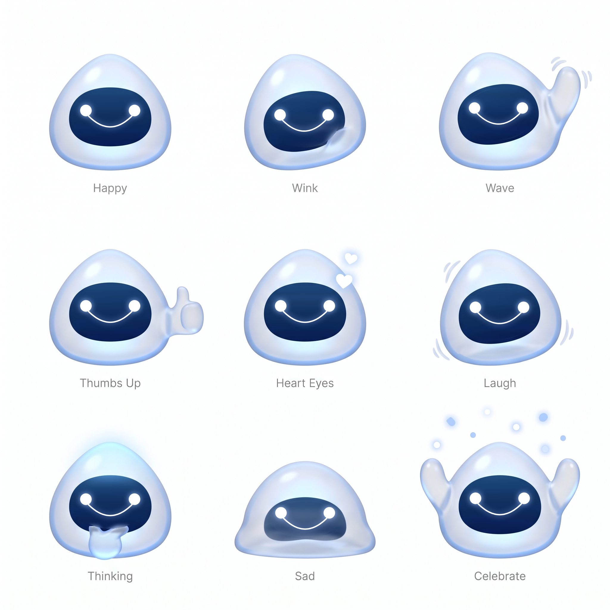
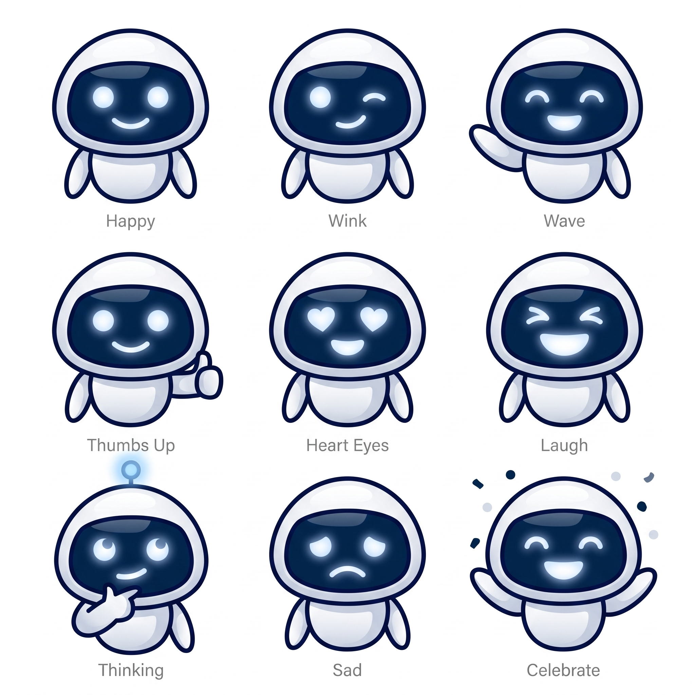

# Rumi Emoji

Emoji / sticker pack for **Rumi**, the AI teaching assistant ([rumi-platform](https://github.com/Orenda-Project/rumi-platform)) —
54 expressions of the desk-companion robot character (see [rumi-mini](https://github.com/Orenda-Project/rumi-mini) for the physical body).

Two bodies, one face. The **slime pack** is the current direction (Sept 2026 team survey: keep the
face, body becomes a cute slime that takes any shape); the **flat-vector robot pack** is the original.
On the slime pack the face is the Rumi logo mark (two dots joined by a smile) rendered as vectors by
`scripts/rumi_face.py` — each emotion reshapes the dots / bends the curve (heart eyes, `><` laugh,
frown, x-eyes…) while the ends stay attached, and `scripts/paste_face.py` composites it onto the body.

| Slime (current) | Flat-vector robot (original) |
|---|---|
|  |  |

## Contents

| Path | What |
|---|---|
| `grids-slime/` · `emoji-slime/` · `manifest-slime.json` · `prompts/PROMPTS_SLIME.md` + `slime.json` | **Slime pack** — same 54 names, translucent gel body, logo-mark face. `grids-slime-blank/` = raw faceless model output the pipeline starts from (not for viewing). |
| `grids/` | The 6 source 3×3 grids (2048×2048 JPEG), one theme each (robot pack) |
| `emoji/` | Individual transparent PNGs cut from the grids — `512/` full-size, `128/` Slack/Discord-ready |
| `manifest.json` | The database: every grid → cell → emoji name, plus the palette |
| `prompts/PROMPTS.md` | The exact generation prompts (shared character block + per-grid emotions) — reuse verbatim to regenerate or extend |

## Character spec (short)

White egg-shaped head + pill body + paddle arms (EVE-like), navy `#001F3F` visor and outlines,
glowing white face features with pale-blue `#A8C7FF` glow — the white-on-navy expression of the
Rumi logo mark (two dots connected by a smile). **No orange/coral/gold on the character** — those
are UI/deck accents only.

## The 6 themes

1. **Core reactions** — happy, wink, wave, thumbs-up, heart-eyes, laugh, thinking, sad, celebrate
2. **Agent work states** — done, working, loading, searching, idea, writing, error, warning, blocked
3. **Rest & big feelings** — sleeping, low-battery, surprised, confused, shy, crying, crying-laughing, angry, nervous
4. **Attitude** — smug, mind-blown, eye-roll, facepalm, cool, starstruck, salute, shrug, peek
5. **Teaching** — teaching, graduate, clap, encourage, listening, speaking, 100, trophy, book
6. **Fun extras** — thanks, dance, heart, reading, charging, hello, curious, proud, high-five

## Using as Slack / Discord emoji

Upload the PNGs from `emoji/128/` — names are already Slack-style (`rumi-happy`, `rumi-done`, …).
Slack custom emoji: workspace admin → Customize → Emoji → upload (≤128KB each, these fit).
Discord: Server Settings → Emoji → upload (≤256KB).

## Regenerating / extending

Slime pack: `python3 scripts/generate_slime.py [grid numbers]` →
`python3 scripts/split_grids.py manifest-slime.json emoji-slime` →
`python3 scripts/paste_face.py emoji-slime/512` → `python3 scripts/paste_face.py grids-slime-blank grids-slime --grids` — see `prompts/PROMPTS_SLIME.md`.

Robot pack: everything needed is in `prompts/PROMPTS.md` — keep the shared character paragraph and negative
prompt verbatim and only swap the 9 emotion descriptions (or the style phrase, for pixel/duotone
variants). Generated with an AI image model at 2K; grids are the source of truth, `emoji/` is
derived output.
