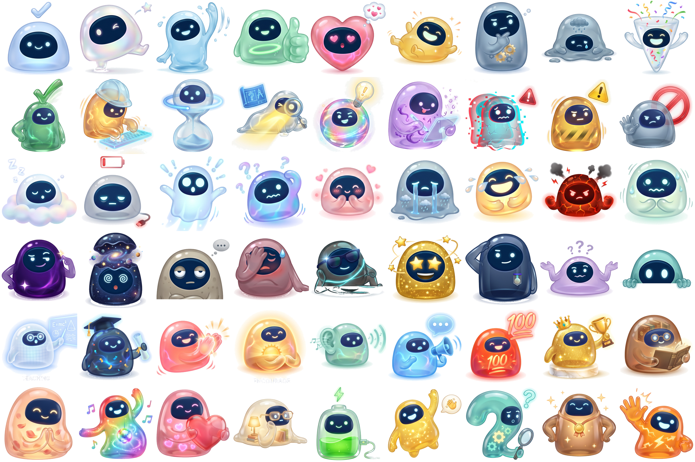
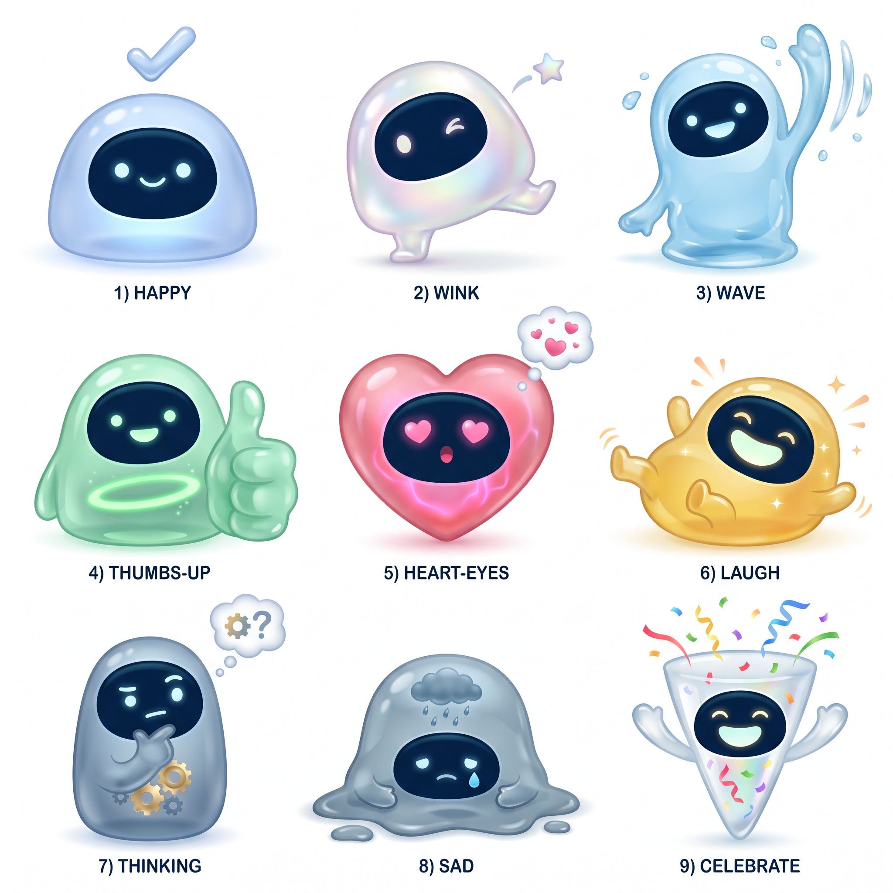
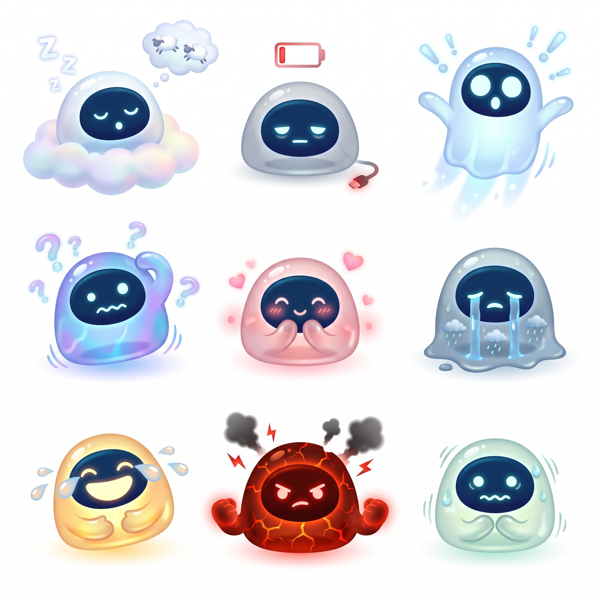
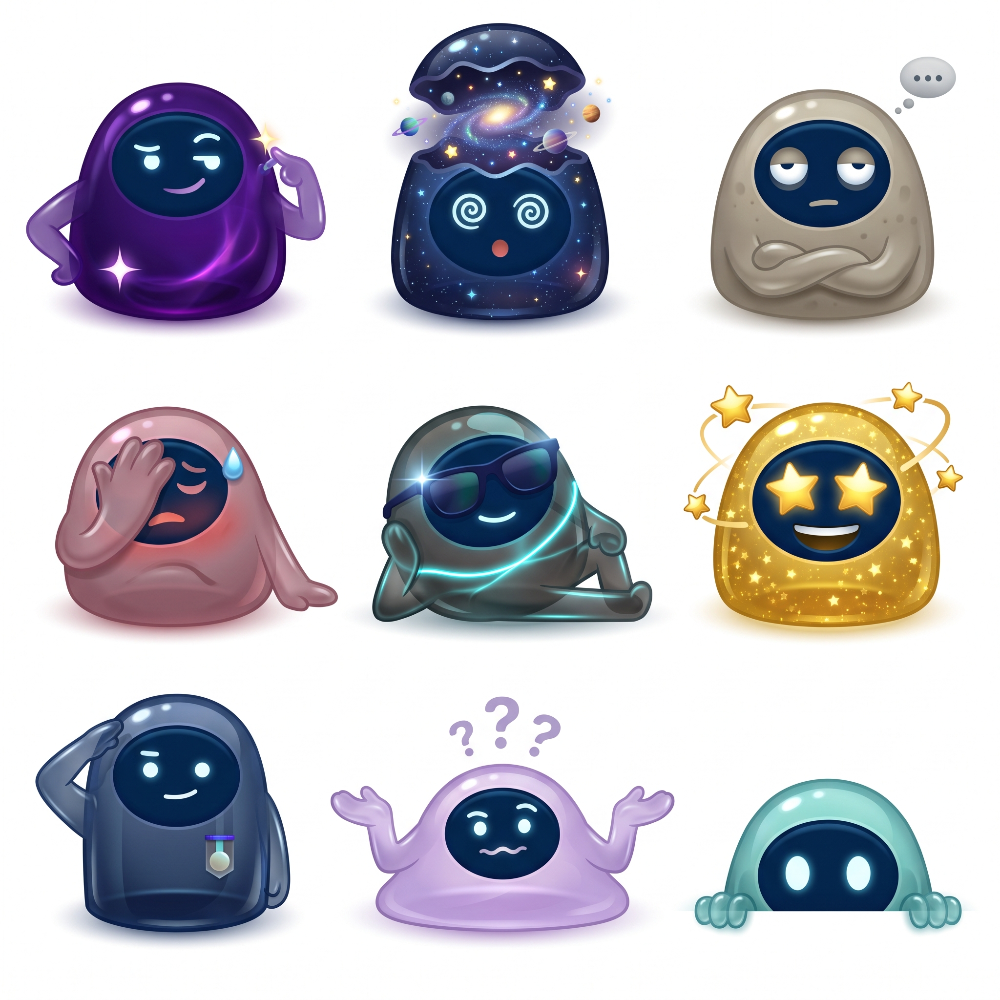
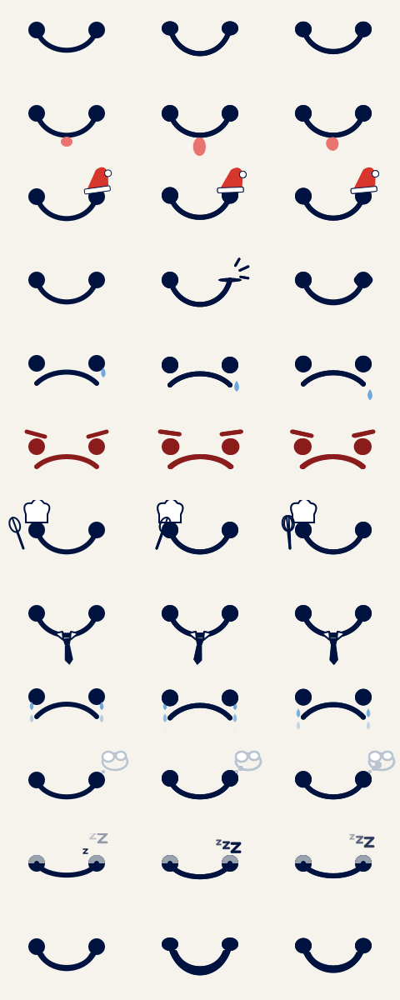

# Rumi Emoji

Emoji / sticker pack for **Rumi**, the AI teaching assistant ([rumi-platform](https://github.com/Orenda-Project/rumi-platform)) —
54 expressions of the desk-companion character (see [rumi-mini](https://github.com/Orenda-Project/rumi-mini) for the physical body).

**Current pack: slime v6.** Rumi is a translucent jelly blob with a navy oval faceplate. The face stays
small and calm (tiny glowing dot eyes, one thin mouth line, eyebrows only when needed). The **body does the
acting**: every one of the 54 emoji has its own material, colour and silhouette — lava when angry, cracked
stone when dead, a rain-cloud puddle when crying, an hourglass when loading, a battery when charging, gold
glitter on a marble pedestal for the trophy. Props live inside the jelly, thought bubbles carry real content.



| Core reactions | Big feelings | Attitude |
|---|---|---|
|  |  |  |

## Using as Slack / Discord emoji

Upload the PNGs from **`emoji-slime-v6/128/`** — names are already Slack-style (`rumi-happy`, `rumi-done`, …).
Slack custom emoji: workspace admin → Customize → Emoji → upload (≤128KB each, these fit).
Discord: Server Settings → Emoji → upload (≤256KB). `emoji-slime-v6/512/` has the full-size versions.

## Meme stickers

Caption + emoji = sticker. 41 office/AI/desi one-liners on v6 bodies, WhatsApp/Telegram-ready. See [`stickers/README.md`](stickers/README.md) for the pack and how to add more.


## Lottie animations of the logo mark

12 animated versions of the Rumi mark itself (two dots + smile): happy, tongue, santa, wink, sad, angry, chef, tie, crying, thinking, sleeping, laugh. Vector JSON for web, Flutter, LottieFiles. See [`lottie/README.md`](lottie/README.md); open `lottie/preview.html` to watch them.



## Contents

| Path | What |
|---|---|
| `grids-slime-v6/` · `emoji-slime-v6/` · `manifest-slime-v6.json` · `prompts/PROMPTS_SLIME_V6.md` + `slime_v6.json` · `preview-slime-v6.png` | **Slime pack v6 (current).** 6 source grids (2048×2048), 54 transparent PNGs in `512/` + `128/`, the grid→cell→name database, and the exact prompts. `grids-slime-v6/v6.0/` = the first pass that was too uniform (kept as a before/after). |
| `lottie/` · `scripts/make_lottie.py` | **Logo-mark Lottie animations** — 12 expressions of the two-dots-and-smile mark as 1s loops; flipbook of parameterised SVG frames. |
| `stickers/` · `scripts/make_stickers.py` | **Meme stickers** — `pack.json` (text + emoji per sticker) → `make_stickers.py` → 512px PNG + WebP + preview. |
| `reference/faces/gemini-9-*.jpeg` | The quality bar v6 was built to match: 4 Gemini reference grids Kamal approved (2026-09-02). The 17 `ref-*.jpeg` files are the earlier face-glyph references. |
| `grids-slime/` · `emoji-slime/` · `manifest-slime.json` · `prompts/PROMPTS_SLIME.md` + `slime.json` · `grids-slime-blank/` | **Slime pack v5 (superseded).** Same 54 names, same pale-blue body in every cell, face = vector logo mark composited on by `scripts/paste_face.py` / `scripts/rumi_face.py`. Kept for history; too uniform to ship. |
| `skills/rumi-face/` | Claude skill: compose a Rumi face from eye + mouth glyphs and put it on a body (v5 pipeline). |
| `grids/` · `emoji/` · `manifest.json` · `prompts/PROMPTS.md` | **Flat-vector robot pack (original).** White egg-shaped robot with paddle arms, 54 emoji, same names. |

## Character spec (slime v6)

- **At rest:** frosted white / pale-blue (`#A8C7FF` glow) translucent jelly dome, deep navy `#001F3F` oval faceplate set into the jelly, glowing white dot eyes joined by one thin smile curve (the Rumi logo mark).
- **Face grammar:** eyes stay small dots by default; big round only for surprised, bulging for panic, spirals for dizzy, hearts for love, closed arcs for laugh/sleep. Mouths: thin smile, filled grin, tongue, open "o", wavy, flat, frown. Thin white eyebrows only when the emotion needs them (angry, skeptical, sick, reading).
- **Body:** changes material, colour, texture and silhouette per emotion. Soft gel arms grow only when a gesture is needed. Props can sit inside the translucent body. The navy faceplate is kept in every cell, whatever colour the body becomes.
- **Palette rule:** white/navy is the resting colour; emotion colours (red lava, gold, green, rainbow, grey stone, pastel cloud) are allowed on the body. Coral/gold as flat brand accents still never appear on the resting character.

## The 6 themes

1. **Core reactions** — happy, wink, wave, thumbs-up, heart-eyes, laugh, thinking, sad, celebrate
2. **Agent work states** — done, working, loading, searching, idea, writing, error, warning, blocked
3. **Rest & big feelings** — sleeping, low-battery, surprised, confused, shy, crying, crying-laughing, angry, nervous
4. **Attitude** — smug, mind-blown, eye-roll, facepalm, cool, starstruck, salute, shrug, peek
5. **Teaching** — teaching, graduate, clap, encourage, listening, speaking, 100, trophy, book
6. **Fun extras** — thanks, dance, heart, reading, charging, hello, curious, proud, high-five

## Regenerating / extending (v6)

```bash
python3 scripts/generate_slime.py --prompts prompts/slime_v6.json [1 2 ...]   # Gemini nano-banana-pro, needs GEMINI_API_KEY
BG_MIN=244 python3 scripts/split_grids.py manifest-slime-v6.json emoji-slime-v6   # cut grids → transparent PNGs
```

Splitter notes: `BG_MIN=244` keeps near-white bodies (iridescent wink, pastel cloud) from being flood-filled
away; grey bodies (low-battery) get eaten by the grey label eraser — re-run that grid with `LABEL_BAND=0`;
navy label text joined to a glow halo needs a manual dark-pixel erase in the bottom band.

Prompt rules that matter (full text in `prompts/PROMPTS_SLIME_V6.md`):

- **Every emotion description must name a body material + colour + silhouette.** Cells described only by face or gesture fall back to the same pale-blue dome — that is exactly what made v5 flat.
- The closing must say no two cells share body colour/material/silhouette, the resting dome appears at most once per grid, and the navy faceplate is kept in every cell (without that line, coloured bodies lose the plate).
- Keep the opening paragraph verbatim for consistency; swap only the 9 emotion lines to add a new grid.

Older pipelines: v5 = `generate_slime.py` (no `--prompts`) → `split_grids.py manifest-slime.json emoji-slime` → `paste_face.py`, see `prompts/PROMPTS_SLIME.md`.
Robot pack = `prompts/PROMPTS.md`, grids are the source of truth, `emoji/` is derived output.
