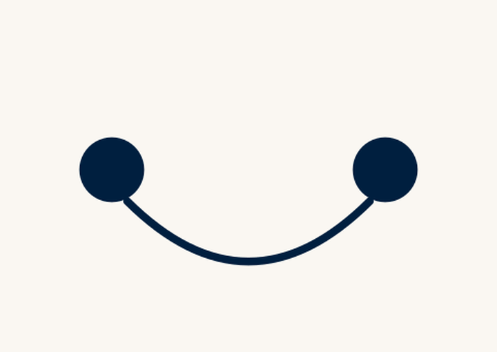
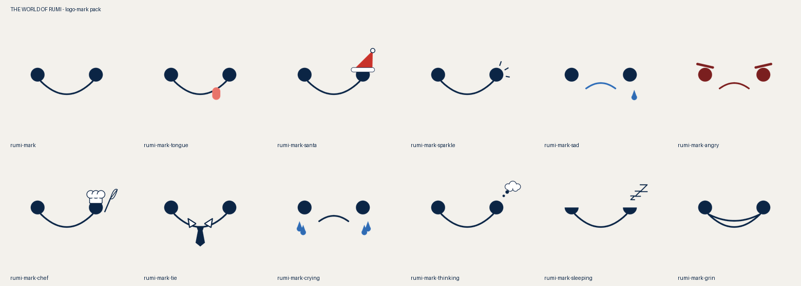
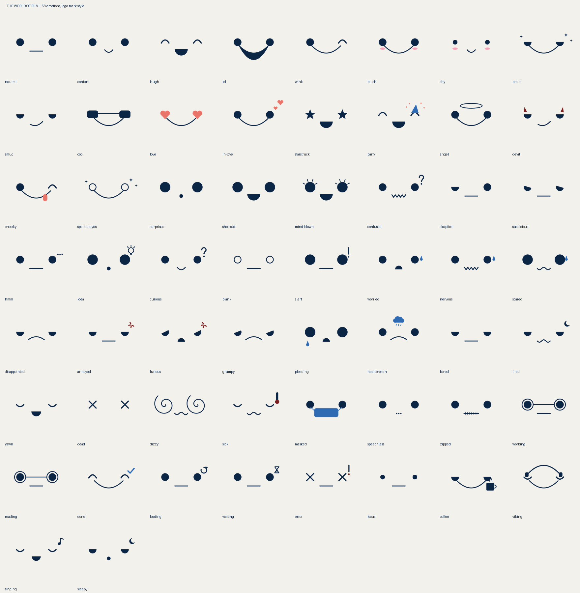
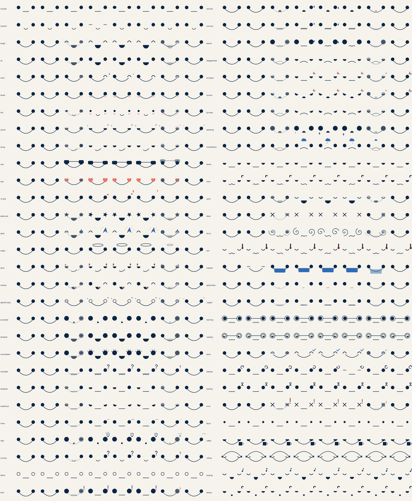

# Rumi Emoji — The World of Rumi

Emoji and stickers for **Rumi**, the AI teaching assistant  ([rumi-platform](https://github.com/Orenda-Project/rumi-platform)).

<p align="center"></p>

**The emoji is the logo.** Two navy dots joined by the smile curve, no body, one small prop hanging off the
mark. Navy on transparent, so it sits on the cream/white of Slack, WhatsApp and Teams. Every file is drawn
as vectors by a small Python renderer, never by an image model, so the mark never drifts.





## Use as Slack / Discord / WhatsApp emoji

Upload the PNGs from **`emoji-mark/128/`** (the 12 originals) and **`emoji-mark-emotions/128/`** (58 emotions).
Names are Slack-style already: `rumi-mark`, `rumi-mark-santa`, `rumi-mark-lol`, `rumi-mark-coffee`, …

- Slack: workspace admin → Customize → Emoji → upload (≤128 KB each, these fit).
- Discord: Server Settings → Emoji → upload.
- The `512/` folders hold full-size versions for stickers, docs and slides.

## Animated (Lottie)

`lottie-mark/` has one animation per emotion (58), `lottie/` the 12 originals with props. Real keyframes,
3-second loops (rest → expression → secondary motion → rest), 3–9 KB each. Open `lottie-mark/preview.html`
to watch them all. See [`lottie-mark/README.md`](lottie-mark/README.md).



## The grammar

```
emoji = eyes + mouth + (at most one prop)
```

- **Eyes are the two logo dots** unless the emotion is *about* the eyes: half-lid (bored, smug, sleepy),
  `^` (laughing), `x` (dead), spiral (dizzy), big dots (surprised), heart/star (love, starstruck).
- **The connected logo curve is the default mouth.** It stays for anything friendly. Disconnected frown,
  flat, open, zigzag or wavy only when the mood needs it. Big laugh = a filled grin hanging off the curve,
  still attached at both eyes, no white teeth.
- **One prop, off to a side, never covering the mark**: up-right of the right eye (sparkle, ?, !, bulb),
  under an eye (tear), on top of an eye (santa, chef, party hat), hanging from the curve (tie, tongue).
- **Colours**: navy `#0B2545`; pale blue `#2F6BB3` for tears, clouds, checks; dark red `#7A1F1F` for anger
  only; coral `#E8746A` for tongue and hearts; pink blush. Nothing else.
- **Simple and minimalistic.** A prop that needs more than a handful of primitives is too detailed for 128 px.

## Making more

```bash
python3 scripts/mark_cli.py list                                        # every name
python3 scripts/mark_cli.py render rumi-mark-lol --out lol.png --bg     # one emoji (--bg = cream preview)
python3 scripts/mark_cli.py compose --eyes lid --mouth flat --prop coffee --out monday.png --bg
python3 scripts/logo_mark_pack.py        # regenerate the 12 originals  -> emoji-mark/ + preview-mark.png
python3 scripts/logo_mark_emotions.py    # regenerate the 58 emotions   -> emoji-mark-emotions/ + preview
python3 scripts/mark_cli.py check emoji-mark-emotions/512               # fails if anything touches the canvas edge
```

Permanent new emotion: one line in `EMOTIONS` in `scripts/logo_mark_emotions.py`. Themed set (Eid, exams,
cricket): a sibling script importing the same primitives. Full glyph list in
[`skills/rumi-logo-mark-emoji/references/vocabulary.md`](skills/rumi-logo-mark-emoji/references/vocabulary.md).
`skills/rumi-logo-mark-emoji/` is the Claude Code skill that encodes all of this; it mirrors
`~/.claude/skills/rumi-logo-mark-emoji`.

## Contents

| Path | What |
|---|---|
| `emoji-mark/` · `preview-mark.png` | The 12 originals from Kamal's "World of Rumi" sheet: mark, tongue, santa, sparkle, sad, angry, chef, tie, crying, thinking, sleeping, grin. `512/` + `128/`. |
| `emoji-mark-emotions/` · `preview-mark-emotions.png` | 58 more emotions in the same grammar: positive, surprise/thinking, negative, work states. |
| `lottie-mark/` · `lottie/` | Lottie animations of the above (`scripts/make_lottie_mark.py`, `make_lottie_v2.py`, `rumi_mark_rig.py`, `rumi_rig.py`). |
| `scripts/logo_mark_pack.py` · `logo_mark_emotions.py` · `mark_cli.py` | The renderer: logo-measured geometry, glyph library, CLI. |
| `skills/rumi-logo-mark-emoji/` | Claude skill: grammar, rules, vocabulary, renderer copies. |
| `reference/faces/world-of-rumi-logo-mark-2026-09-03.jpg` | Kamal's original sheet, ground truth for this style. |
| `experiments/` | Everything that came before and did not make the cut. See below. |

## experiments/ (not the product)

Earlier directions, kept for history and reuse of parts. Each one's scripts live in
`experiments/scripts/` and resolve paths relative to `experiments/`.

| Path | What it was |
|---|---|
| `experiments/grids-slime-v6/` · `emoji-slime-v6/` · `manifest-slime-v6.json` · `prompts/slime_v6.json` | Slime body pack v6: translucent jelly blob with a navy faceplate, body material changes per emotion (Gemini nano-banana-pro + `split_grids.py`). 54 emoji. |
| `experiments/grids-slime/` · `emoji-slime/` · `grids-slime-blank/` · `manifest-slime.json` | Slime v5: same body every cell, face composited as vectors (`paste_face.py`, `rumi_face.py`). |
| `experiments/grids/` · `emoji/` · `manifest.json` · `prompts/PROMPTS.md` | Flat-vector robot pack, the first attempt. Also `emoji/gif/` animation prototypes. |
| `experiments/stickers/` · `scripts/make_stickers.py` | Caption + slime-v6 emoji meme stickers (office / AI / Roman Urdu one-liners). |
| `experiments/skills/rumi-face/` | Claude skill for composing a face onto a body (v5 pipeline). |
| `reference/faces/gemini-9-*.jpeg`, `ref-*.jpeg` | Reference grids and face renders the body packs were built against. |

`gauntlet/` (local A/B runs, ~3 GB) is git-ignored.
