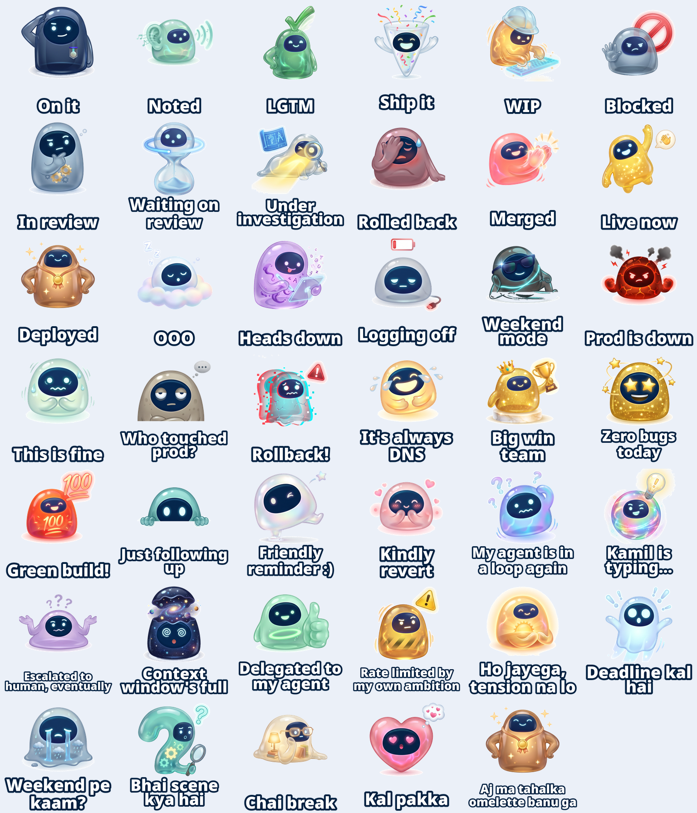

# Rumi Meme Stickers

Meme / reaction stickers built from the v6 emoji: one Rumi body + one caption, 512×512, transparent.
Made for Slack, WhatsApp and Telegram. The emoji carry the emotion, the text carries the office joke.



## Packs

| Pack | What | Count |
|---|---|---|
| `rumi-office-v1/` | Office shorthand (On it, LGTM, Blocked, Prod is down…), AI-coworker lines (My agent is in a loop again, Kamil is typing…), desi office (Ho jayega tension na lo, Kal pakka, Chai break, Aj ma tahalka omelette banu ga) | 41 |

Each pack folder has `png/` (512×512, Slack/Telegram), `webp/` (512×512 under 100KB, WhatsApp) and `preview.png`.

## How we make memes here

The whole pipeline is one JSON file and one script.

1. **Pick the line.** Captions come from the text bank in `personal-agent-v2/vault/content/sticker-pack-text.md`
   (~550 researched one-liners: developer jokes, AI/agent jokes, office shorthand, Roman Urdu office lines).
   Rule of thumb: 6 words or fewer reads best at sticker size. Anything longer gets two lines and a smaller font.
2. **Pick the body.** One of the 54 v6 emoji in `emoji-slime-v6/512/`. Match the body's *material* to the joke,
   not just the face: lava for "Prod is down", hourglass for "Waiting on review", gold trophy for "Big win team",
   melting rain-cloud puddle for "Weekend pe kaam?". Never reuse the same emoji twice in one pack — every sticker
   should be recognisable from the picture alone.
3. **Add a row to `pack.json`** (or copy it to `pack-<name>.json` for a new pack):
   ```json
   {"file": "prod-is-down.png", "text": "Prod is down", "emoji": "rumi-angry"}
   ```
4. **Render.**
   ```bash
   python3 scripts/make_stickers.py stickers/pack.json
   ```
   Writes `png/`, `webp/` and `preview.png` into `stickers/<pack>/`. The script asserts every WebP is under
   WhatsApp's 100KB cap and fails loudly if not.
5. **Look at `preview.png`** before committing. If a caption wraps badly, shorten the text; don't fight the layout.

## Layout rules baked into the script

- Emoji fills the top ~70% of the canvas, centred; caption sits in the bottom ~30%.
- Caption is white Noto Sans Black with a navy `#001F3F` outline so it reads on any chat background, light or dark.
  (Inter is the Rumi brand font; swap the `FONT` path in the script if it is installed.)
- Font auto-shrinks from 72px down to 30px and wraps to at most two lines.
- Ponytail: no per-sticker layout overrides. If a sticker needs special treatment, it needs a shorter caption.

## Uploading

- **Slack:** custom emoji take the 128px v6 emoji, not these stickers (Slack has no sticker format). Post stickers as images in threads, or upload `png/` files to a shared album.
- **WhatsApp:** import `webp/` with any "sticker maker" app; each file is already 512×512 and under 100KB. A tray icon needs to be 96×96, resize any sticker.
- **Telegram:** send `png/` files to @Stickers → `/newpack`. Telegram accepts 512px PNG with transparency as-is.

## Ideas queued (not built)

- *Dev Daily* pack from Part A of the text bank (bugs, git, code review).
- *Taleemabad inside jokes* pack from Part D of the text bank. Internal only, keep out of any public export.
- Meme-template variant: paste a v6 emoji onto a classic template (this-is-fine, drake, two-buttons) instead of the plain caption layout.
