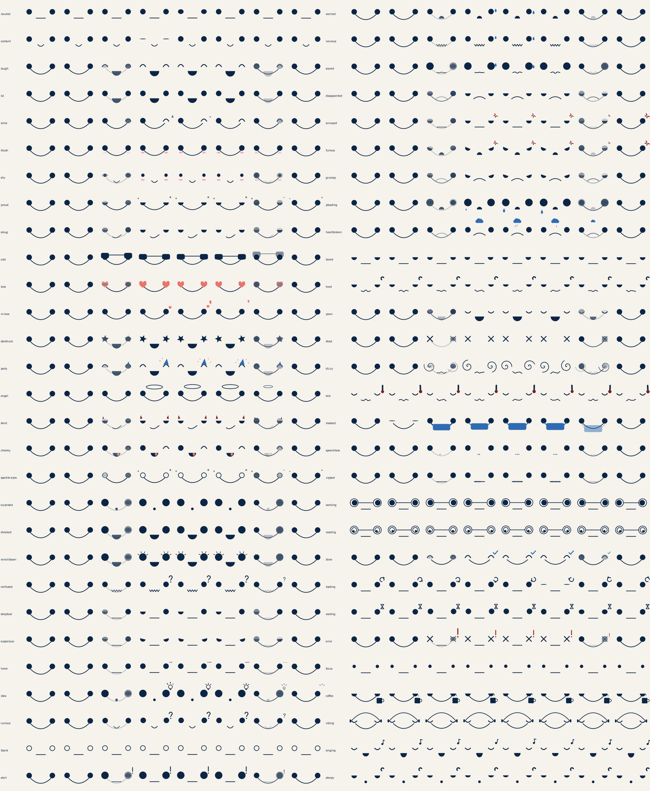

# Rumi mark — 58 Lottie states

Every emoji in `emoji-mark-emotions/` as a Lottie animation, same 512 canvas, same geometry, brand navy `#001F3F`,
so a static PNG and its animation are interchangeable. 3–9 KB each.

Open `preview.html` to watch all of them (lottie-web from cdnjs).



## Two grammars

- **Reaction** (most): rest 0–0.8 s with a blink → the expression arrives (eyes crossfade 120 ms, right eye 60 ms after
  the left; mouth 140 ms; prop pops 0→112→100 %) → holds to 2.3 s with a secondary motion → returns → rest to 3 s.
- **Status** (working, reading, loading, waiting, focus, coffee, vibing, singing, sleepy, tired, bored, sick, blank,
  neutral, content): the state is held for the whole loop; the secondary motion loops seamlessly (spinner turns,
  hourglass flips at 1.2 s, steam rises, note bobs, pupils scan a line, headphones nod).

## The rig (`scripts/rumi_mark_rig.py`)

- `Eye` and `Mouth` are **Parts**: a group of variant shapes (eye: dot, big, small, ring, lid, arch, closed, x, heart,
  star, spiral, look · mouth: link curve, flat, small, frown, smirk, o, open, openfrown, zigzag, wavy, teeth, tongue,
  dots, zip, none). `part.set(state, t)` records a state change; `bake()` turns the timeline into opacity crossfades.
  Leaving/entering the round dot also squashes it flat, the way the reference listening video does.
- Props are groups anchored at their pivot with recipes: `pop`, `fade`, `overshoot`, `wobble`, `shake`, draw-on via `Trim`.
- `scripts/make_lottie_mark.py`: one small function per emotion. `react(...)` and `status(...)` set the grammar; the rest
  is that emotion's secondary motion.

```bash
python3 scripts/make_lottie_mark.py            # all 58 -> lottie-mark/
python3 scripts/make_lottie_mark.py idea sick  # some
```

## Lottie gotchas this set hit (also in the `lottie-motion` skill)

1. The **first shape in a group renders on top**; `insert(0, …)` = front, `add_shape` = behind.
2. A **Fill or Stroke styles every shape above it in the same group**. Put each shape in its own subgroup or your
   outlined ring turns into a filled disc (this happened to the bulb, spinner, hourglass, glasses, headphones).
3. Two state changes at the same frame sort alphabetically unless you give the baseline an earlier time.
4. An animated property with a single keyframe breaks lottie-web silently; write a static value instead.
5. A `Trim`-ed stroke at 0 % length still draws a round-cap dot; hide the group until the draw-on starts.
6. python-lottie's `export_png` ignores `dpi`; resize the 512 image yourself.
