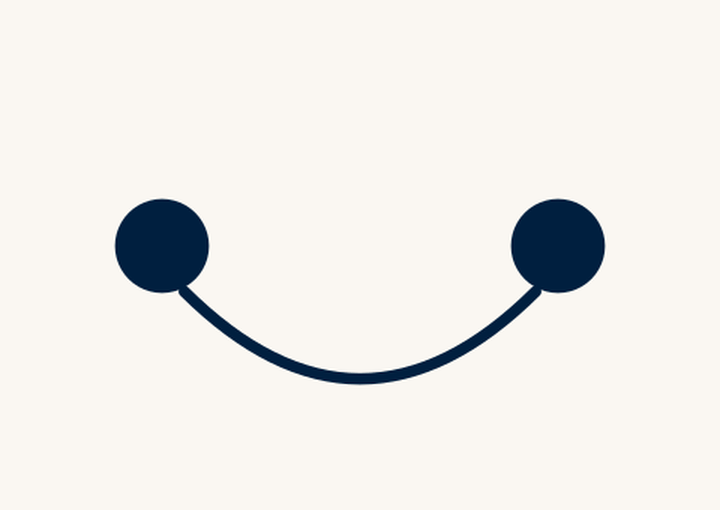

# Rumi mark — 58 Lottie states

Every emoji in `emoji-mark-emotions/` as a Lottie animation, same 512 canvas, same geometry, brand navy `#001F3F`,
so a static PNG and its animation are interchangeable. 3–9 KB each.

Open `preview.html` to watch all of them (lottie-web from cdnjs).



 /  / : one mark morphing through twelve moods in 19 s, made by  from the same rig (each beat 1.5 s). The GIF is the README hero; the JSON plays in any Lottie player.


## Two grammars

- **Reaction** (most): rest 0–0.8 s with a blink → the expression arrives (eyes crossfade 120 ms, right eye 60 ms after
  the left; mouth 140 ms; prop pops 0→112→100 %) → holds to 2.3 s with a secondary motion → returns → rest to 3 s.
- **Status** (working, reading, loading, waiting, focus, coffee, vibing, singing, sleepy, tired, bored, sick, blank,
  neutral, content): the state is held for the whole loop; the secondary motion loops seamlessly (spinner turns,
  hourglass flips at 1.2 s, steam rises, note bobs, pupils scan a line, headphones nod).

## The rig (`scripts/rumi_mark_rig.py`)

- `Eye` is **one filled path with 12 vertices that morphs** between dot, big, small, lid, arch, closed, heart, star and x
  (every shape is normalised to 12 vertices by exact bezier subdivision, and rotated to start at its left-most point so
  vertices correspond). Dot → arch/lid/closed goes through a flattened "squash" keyframe first, the way the reference
  listening video does. Ring, spiral and look are stroke-based and crossfade.
- `Mouth` is **one 9-vertex stroked path that morphs** between the link curve, flat, small, frown, smirk, wavy and zigzag,
  plus a 12-vertex filled path (open, openfrown, o). Stroke → filled: the curve flattens into the mouth's top edge while
  the filled shape opens downward from it with a 12 % overshoot; closing reverses it. Teeth, tongue, dots and zip ride on top.
- `part.set(state, t)` records a state change; `bake()` writes the shape keyframes.
- Props are groups anchored at their pivot with recipes: `pop`, `fade`, `overshoot`, `wobble`, `shake`, draw-on via `Trim`.
- `scripts/make_lottie_mark.py`: one small function per emotion. `react(...)` and `status(...)` set the grammar; the rest
  is that emotion's secondary motion.

```bash
python3 scripts/make_lottie_mark.py            # all 58 -> lottie-mark/
python3 scripts/make_lottie_mark.py idea sick  # some
```

## Lottie gotchas this set hit (also in the `lottie-motion` skill)

1. The **first shape in a group renders on top**; `insert(0, …)` = front, `add_shape` = behind.
2. A **Fill or Stroke styles every shape above it in the same group**. Put each shape in its own subgroup or your
   outlined ring turns into a filled disc (this happened to the bulb, spinner, hourglass, glasses, headphones).
3. Two state changes at the same frame sort alphabetically unless you give the baseline an earlier time.
4. An animated property with a single keyframe breaks lottie-web silently; write a static value instead.
5. A `Trim`-ed stroke at 0 % length still draws a round-cap dot; hide the group until the draw-on starts.
6. python-lottie's `export_png` ignores `dpi`; resize the 512 image yourself.
