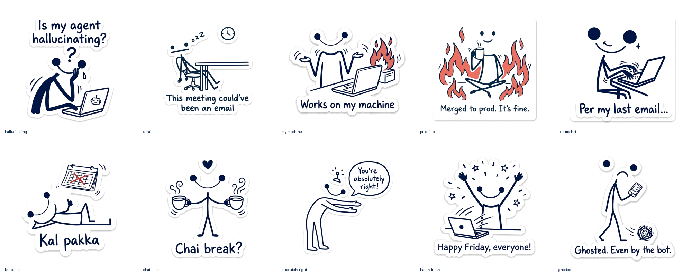

# Rumi meme stickers (ink webcomic style)

Company meme stickers in the "World of Rumi" language: a hand-drawn navy-ink stick figure whose head is
**only the Rumi mark** (two dots joined by the smile curve, no head circle), one caption, white die-cut.



## How they were made

1. **Captions** were picked from `personal-agent-v2/vault/content/sticker-pack-text.md` — the research bank
   of dev / AI-coworker / office / Roman Urdu / Taleemabad-internal lines. Ten that are relatable to the whole
   company, ≤5 words where possible, one internal joke ("Ghosted. Even by the bot.").
2. **Style prompt** is Kamal's brief, adapted for brand: *minimalist hand-drawn stick figure webcomic sticker,
   bold ink line art, doodle aesthetic, white background, motion lines, hand-drawn caption, sarcastic office
   humor, die-cut sticker* — with black swapped for navy `#0B2545` and coral `#E8746A` allowed as the one
   accent (flames).
3. **The face is never described in prose.** `face-reference.png` (the navy mark) is sent to Gemini
   `nano-banana-pro-preview` as a reference image with a role text saying "this IS the head, no circle, no
   extra features". Describing the logo in words makes the model invent a new one every run (learned on the
   slime packs). Even with the reference, the first pass drew a head circle on 4/10; adding "a head circle is
   a failed image" to the role text fixed 4/4 on the second pass.
4. **Scenes** are one sentence each in `prompts.json` — body language + one or two props + which mouth
   variant (smile / flat / smirk / frown). The model draws the caption itself (part of the style); all ten
   came out spelled correctly at 1K.
5. **Die-cut**: `generate_memes.py --sheet` turns near-white (>235) to transparent → `png/rumi-meme-<id>.png`
   and rebuilds `preview.png` from the cut versions. `raw/` keeps the untouched Gemini output.

## Batches

- `raw/`, `png/`, `preview.png` here: the first 10 general office/AI stickers.
- [`taleemabad/`](taleemabad/README.md): 16 Taleemabad-specific stickers (team rituals + school reality). Own `prompts.json`; run with `--prompts memes/taleemabad/prompts.json`.
- [`dev-ai/`](dev-ai/README.md): 16 dev + AI-coworker stickers, **2K** for print.
- [`desi-office/`](desi-office/README.md): 16 Roman Urdu office + classroom stickers, **2K** for print.

58 stickers total across the four batches. Set `"imageSize": "2K"` in a batch's `prompts.json` for print-grade output (1K is fine for chat).

## Files

| Path | What |
|---|---|
| `prompts.json` | Model, reference role text, style, negative, and the 10 sticker scenes + captions. Edit here. |
| `face-reference.png` | The navy mark sent as the face reference (copy of `rumi-brand/assets/rumi-mark-navy-transparent.png`). |
| `raw/<id>.png` | Untouched 1024² Gemini output. |
| `png/rumi-meme-<id>.png` | Background removed, ready for WhatsApp/Slack/Telegram. |
| `preview.png` | Contact sheet of the cut stickers. |
| `../scripts/generate_memes.py` | Generator + sheet builder. |

## Making more

```bash
# add a sticker to prompts.json, then:
python3 scripts/generate_memes.py <id>          # generates only ids without a raw file, then rebuilds the sheet
rm memes/raw/<id>.png && python3 scripts/generate_memes.py <id>   # reroll a reject
python3 scripts/generate_memes.py --sheet       # just rebuild png/ + preview
```

Needs `GEMINI_API_KEY` (env or `personal-agent-v2/.env`). ~10 s per sticker.

## Review notes (2026-09-03, first batch)

Strong: hallucinating, my-machine, chai-break, happy-friday, ghosted, kal-pakka, email.
Weaker mark fidelity: `prod-fine` (dots small, smile separate), `per-my-last` (smile not attached to the
dots), `absolutely-right` (antenna makes it read as a robot). Reroll candidates.
