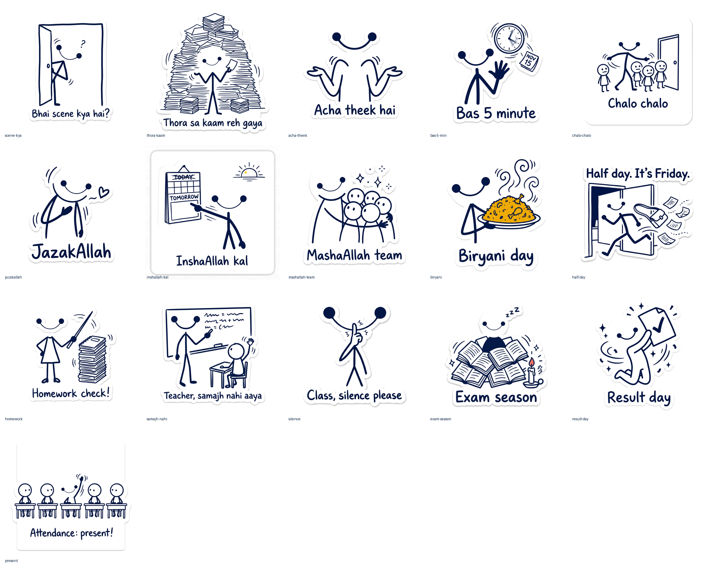

# Desi office & classroom batch — 16 stickers, 2K for print

Roman Urdu office lines (Part C cat 11) plus classroom moments: teacher, students, exams, results, biryani day. Same recipe as [`../README.md`](../README.md); generated at **2K** (2048²) so they hold up printed.

| id | caption |
|---|---|
| scene-kya | Bhai scene kya hai? |
| thora-kaam | Thora sa kaam reh gaya |
| acha-theek | Acha theek hai |
| bas-5-min | Bas 5 minute |
| chalo-chalo | Chalo chalo |
| jazakallah | JazakAllah |
| inshallah-kal | InshaAllah kal |
| mashallah-team | MashaAllah team |
| biryani | Biryani day |
| half-day | Half day. It's Friday. |
| homework | Homework check! |
| samajh-nahi | Teacher, samajh nahi aaya |
| silence | Class, silence please |
| exam-season | Exam season |
| result-day | Result day |
| present | Attendance: present! |

Rerolls: 6/16 (scene-kya, thora-kaam, bas-5-min, inshallah-kal, mashallah-team, present) drew a head circle on the first pass.
Fixed by putting "IMPORTANT: Rumi has NO head circle…" as the FIRST sentence of the scene. Scenes with other
stick figures (crowds, classrooms) or with something on/near the head (helmet, door frame, paper pile) are the
ones that fail — say explicitly that only the *other* figures may have circle heads.
