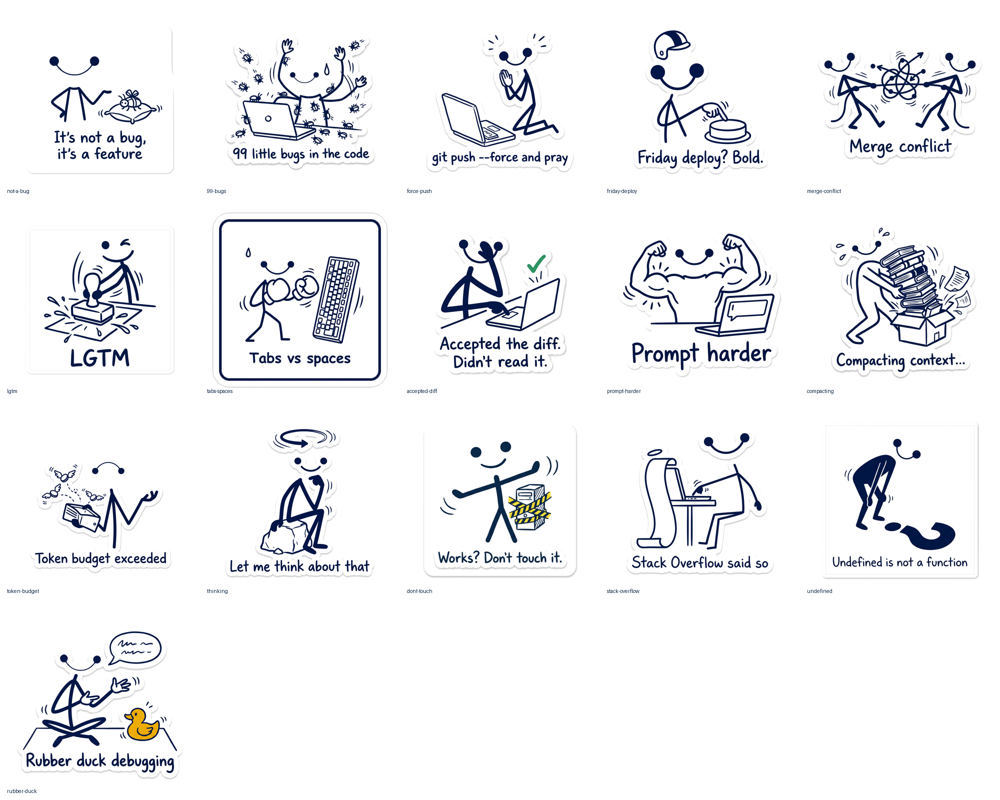

# Dev & AI life batch — 16 stickers, 2K for print

Programmer and AI-coworker humour from the sticker text bank Parts A/B: bugs, git, deploys, code review, prompts, tokens, context compaction. Same recipe as [`../README.md`](../README.md); generated at **2K** (2048²) so they hold up printed.

| id | caption |
|---|---|
| not-a-bug | It's not a bug, it's a feature |
| 99-bugs | 99 little bugs in the code |
| force-push | git push --force and pray |
| friday-deploy | Friday deploy? Bold. |
| merge-conflict | Merge conflict |
| lgtm | LGTM |
| tabs-spaces | Tabs vs spaces |
| accepted-diff | Accepted the diff. Didn't read it. |
| prompt-harder | Prompt harder |
| compacting | Compacting context... |
| token-budget | Token budget exceeded |
| thinking | Let me think about that |
| dont-touch | Works? Don't touch it. |
| stack-overflow | Stack Overflow said so |
| undefined | Undefined is not a function |
| rubber-duck | Rubber duck debugging |

Rerolls: 2/16 (force-push, friday-deploy) drew a head circle on the first pass.
Fixed by putting "IMPORTANT: Rumi has NO head circle…" as the FIRST sentence of the scene. Scenes with other
stick figures (crowds, classrooms) or with something on/near the head (helmet, door frame, paper pile) are the
ones that fail — say explicitly that only the *other* figures may have circle heads.
