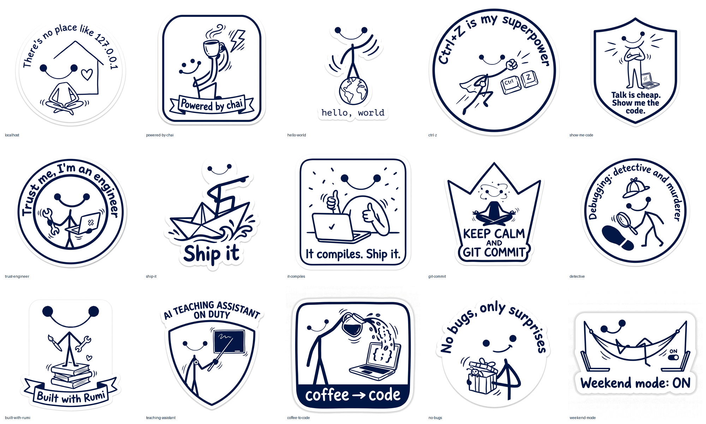

# Laptop batch — 15 stickers, 2K for print

Identity stickers for laptops: badge / shield / ribbon compositions, short bold captions, the same navy-ink
Rumi with the mark for a head. Style block differs from the meme batches: "bold badge/emblem composition,
thick strokes that read from two metres away, caption integrated into the badge (arched, ribbon, stacked)".

| id | caption |
|---|---|
| localhost | There's no place like 127.0.0.1 |
| powered-by-chai | Powered by chai |
| hello-world | hello, world |
| ctrl-z | Ctrl+Z is my superpower |
| show-me-code | Talk is cheap. Show me the code. |
| trust-engineer | Trust me, I'm an engineer |
| ship-it | Ship it |
| it-compiles | It compiles. Ship it. |
| git-commit | Keep calm and git commit |
| detective | Debugging: detective and murderer |
| built-with-rumi | Built with Rumi |
| teaching-assistant | AI teaching assistant on duty |
| coffee-to-code | coffee → code |
| no-bugs | No bugs, only surprises |
| weekend-mode | Weekend mode: ON |

Rerolls: 4/16 drew a head circle (localhost, trust-engineer, detective fixed on one reroll). **`404: sleep not
found` was dropped after 3 attempts** — any "asleep / slumped / half-closed eyes" description makes the model
draw a round head with eyes, no matter how the no-circle rule is phrased. Avoid sleeping poses in this style;
use the vector `rumi-mark-sleeping` emoji instead if a sleepy sticker is needed.
