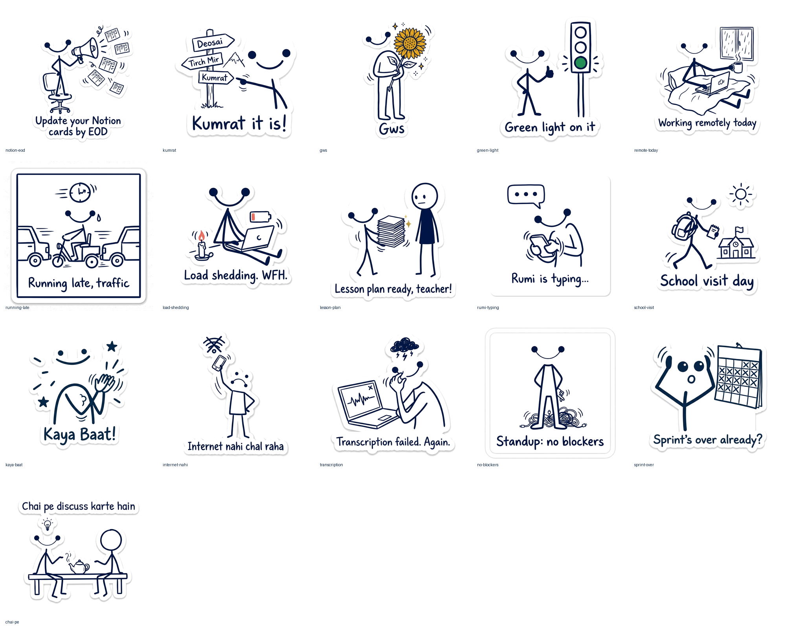

# Taleemabad batch — 16 stickers

Same recipe as [`../README.md`](../README.md) (ink stick figure, head = the mark, one caption, Gemini
nano-banana-pro with `face-reference.png`). Captions are the team's own words, mined from Slack on
2026-09-02, plus school-side reality.

| id | caption | where it comes from |
|---|---|---|
| notion-eod | Update your Notion cards by EOD | recurring reminder in #model-sovereignty |
| kumrat | Kumrat it is! | meeting rooms named after valleys, announced daily (Deosai / Tirch Mir / Kumrat) |
| gws | Gws | the #presence get-well ritual, sunflower reaction |
| green-light | Green light on it | approval sign-off phrase in region channels |
| remote-today | Working remotely today | #presence daily |
| running-late | Running late, traffic | #presence daily |
| load-shedding | Load shedding. WFH. | Pakistan office reality |
| lesson-plan | Lesson plan ready, teacher! | what Rumi does |
| rumi-typing | Rumi is typing... | how people talk to the bot |
| school-visit | School visit day | field team |
| kaya-baat | Kaya Baat! | praise catchphrase |
| internet-nahi | Internet nahi chal raha | school internet |
| transcription | Transcription failed. Again. | classroom-audio pipeline incidents |
| no-blockers | Standup: no blockers | fingers crossed behind the back |
| sprint-over | Sprint's over already? | sprint humour |
| chai-pe | Chai pe discuss karte hain | how decisions actually get made |

Rerolls needed: 6 of 16 drew a head circle on the first pass even with the strengthened role text; adding
"NO head circle: only the two floating dots and the curve" **inside the scene sentence** fixed 5/6, one
needed a second reroll. Lesson for `prompts.json`: repeat the no-circle rule in the scene, not only in the
role text, for scenes with a lot going on (megaphone, bed, crowd).

Dropped by Kamal: a "@Kamil go" sticker (agent-specific, not for the company pack).
